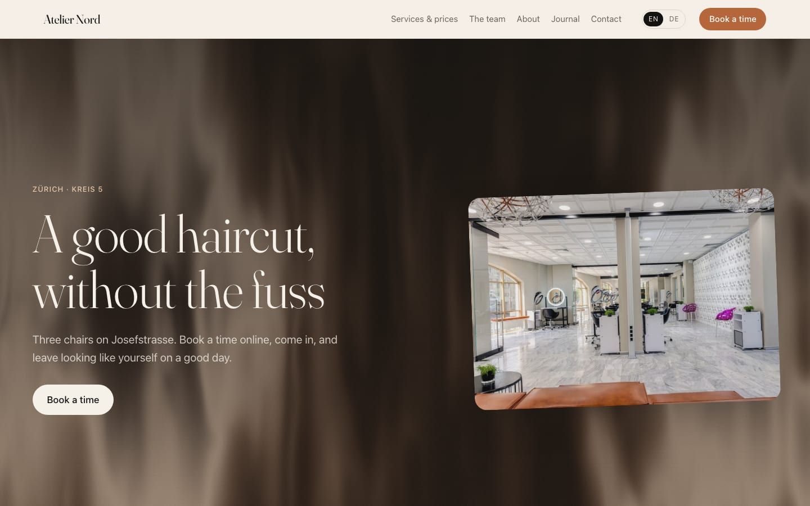

# Atelier Nord — a sample site on jtakeit

**Live: https://atelier-nord-8c4b.jtakeit.site**



Atelier Nord is a three-chair hair salon in Zürich that does not exist. It is the
sample site for [jtakeit](https://jtakeit.com): a real Astro project, written by an
AI agent from a brief, that shows what a client site on the platform looks like
from the inside — and what the business owner gets from the outside.

The salon, its people and its customers are invented. The photographs are real,
from Pexels, and credited in [CREDITS.md](CREDITS.md).

## What it shows

- **Online booking.** Services with a length and a price, three masters with
  their own hours, free times read from the platform, paid on the spot.
  The form posts to the platform's diary on the site's own host.
- **Owner editing.** Every word the owner may change is declared in
  [`src/content/blocks.ts`](src/content/blocks.ts) and marked in the built HTML;
  in the jtakeit panel the owner taps the text on the page and types. There is
  no "add block" button, so the layout stays the developer's.
- **Two languages**, English and German, at the same addresses with the
  language in front (`/services/`, `/de/services/`), with hreflang.
- **A journal** — posts the owner writes in the panel, listed and in the sitemap.
- **What the platform checks on every build** — sitemap, robots, canonicals,
  structured data and `llms.txt` are written by the build, and a build that
  would hide the site from search is refused.

## What is where

| | |
| --- | --- |
| `BRIEF.md` | the brief the agent built from — facts with their sources, decisions, what is still open |
| `src/content/blocks.ts` | what the owner may edit, block by block; `jtk/catalogue.json` is generated from it |
| `jtk/content/` | the words, one JSON document per page and language — what the panel edits |
| `jtk/bookings.json` | opening hours and booking settings, the same ones the owner changes in the panel |
| `jtk/site.json` | the business's facts: name, currency, address |
| `src/` | the site itself — layouts, components, styles; plain Astro |

## Running it

Node 22.12 or newer.

```bash
npm ci
npm run dev                     # http://localhost:4321
npm run build                   # static output in dist/
npx @jtakeit/astro catalogue    # check the catalogue against the built pages
```

The pages, the design and the content all run locally. Three things need the
platform and will not work from a clone: the booking form (free times and
bookings), the enquiry form (`/api/lead`), and the photographs uploaded through
the panel, which are served from jtakeit's media host.

## Building your own

Start from the scaffold:

```bash
npx @jtakeit/astro create my-site --name "My Business" --locale en --kit salon
```

The scaffold, the catalogue tool and their documentation are in
[jtakeit/jtakeit-kit](https://github.com/jtakeit/jtakeit-kit). To build, preview and
launch on the platform, connect your agent to jtakeit's MCP server at
`https://mcp.jtakeit.com/mcp`; it signs in through the browser the first time.
Building and previews are free; a site is paid for once it goes live.

## Licence

The code and the words are MIT — see [LICENSE](LICENSE). The photographs in
`src/assets/` are not: they remain under the [Pexels License](https://www.pexels.com/license/),
as listed in [CREDITS.md](CREDITS.md).
